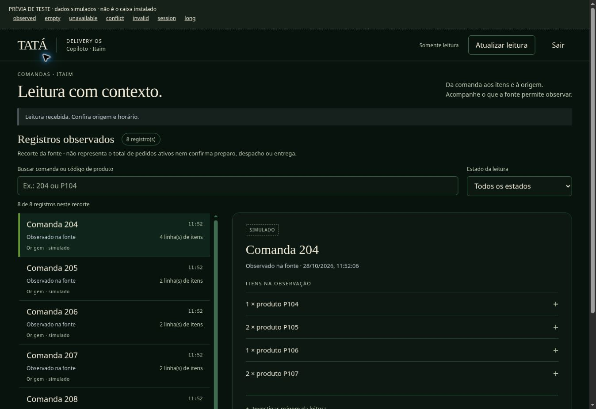

# Leitor do Copiloto — implementação visual verificada

Data: 2026-10-28. Escopo: `/copiloto/pedidos/`, leitor autenticado somente leitura, Itaim.

A Home `/` continua sendo a experiência operacional canônica. Este trabalho melhora o leitor isolado; não substitui nem conclui a Home. Revisão inicial: [auditoria](REVISAO_COPILOTO_PILOTO_2026-10-28.md).

## Entrega

- Lista e investigação em duas colunas no desktop; navegação vertical com retorno à lista no celular.
- Busca por comanda/código de produto e filtro por estado da fonte.
- Detalhes progressivos por item e origem. Catálogo e praça desconhecidos ficam explícitos; não há inferência pelo código.
- Seleção e detalhes abertos preservados após revalidação da mesma comanda. Dados anteriores são removidos durante a busca e não permanecem em falhas.
- Paleta canônica e durações de Motion carregadas pelo servidor; transições discretas, sem pressão ou fluxo fictícios, e regra CSS de movimento reduzido.
- Quantidades representam registros do recorte, não fila ativa completa nem autorização de despacho.

## Evidência visual

Capturas reais da interface implementada, usando dados sintéticos identificados. Não são capturas do Caixa Mooca nem prova de leitura de comandas reais.

[Investigação no quadro de 390 × 844](evidencias/copiloto-leitor-2026-10-28/mobile-investigacao-simulada.jpg). O quadro responsivo não representa teste em aparelho físico.

Navegador: busca, seleção, abertura de item/origem e preservação após atualizar conferidas. Estados conflitante, indisponível e inválido não mostraram itens antigos. Sem rolagem horizontal no desktop observado e nos quadros de 390 e 320 px; o quadro de 320 px recebeu 250 registros sintéticos e códigos longos. Retorno à lista restaura foco. Movimento reduzido foi conferido no CSS, sem emulação de preferência nesta sessão.

## Verificação técnica

- Build TypeScript passou.
- HTTP: 6/6; piloto montado: 9/9; sessão Neon: 18/18.
- Autoridade de leitura: 13/13 na etapa anterior desta revisão.
- Ponte M1 compilada: 40/40. Execução via tsx bloqueada por IPC EPERM no ambiente; execução do mesmo teste compilado passou.
- Testes de navegador automatizados ampliados para busca/filtro/detalhes/revalidação; dependem da próxima CI. As verificações interativas acima não substituem a suíte completa.
- Assets HTTP incluem tokens canônicos, duração de Motion, regra de movimento reduzido e layout de investigação, sem importação externa.

## Instalação e limites

O pacote precisa incluir `src/product/ui/tokens/organismo-tokens.css` e `docs/figma/MOTION_TOKENS.json`, além dos assets do leitor. O servidor de revisão exige `READER_UI_LAB=1`, usa dados simulados e não deve integrar a inicialização de produção.

Não instalado no Caixa Mooca. Acesso remoto permanece indisponível por quota; não foi repetido. Faltam a integração da entrada na Home, mapeamento real de catálogo/praças, ensaio de Motion e ergonomia no equipamento efetivo, ativação autenticada e comprovação ponta a ponta com fonte real. GPS físico e integração iFood não fazem parte desta entrega. Não declarar 10/10 operacional.

## Continuidade — foco e entrada pela Home

A revalidação agora registra a posição de teclado por identidade de comanda/item e restaura o foco sem rolar a página, somente se a pessoa não tiver mudado de foco durante a resposta. A restauração não ocorre em leitura inválida, sessão negada ou registro removido. Busca e filtro também preservam foco. Acrescentados dois controles à suíte de navegador: atualização com item focado e mudança deliberada para busca enquanto a resposta está retida. Verificação HTTP local: 6/6; controles novos de navegador aguardam CI.

A integração da Home não foi aplicada como um link isolado: `tools/product_system_server.ts` recusa POST e tem uma fronteira shadow distinta do login individual. Já `tools/entregas_pilot_server.ts` monta o runtime autenticado, cujo namespace fica indisponível sem configuração válida. Ligar as superfícies exige primeiro uma composição explícita no mesmo host aprovado, com o runtime de autenticação recebendo suas rotas antes da recusa de métodos do servidor de apresentação, mantendo essa recusa nas demais rotas. Depois, uma entrada de navegação condicionada à disponibilidade do leitor para Itaim, sem dados de pedidos na Home e sem considerar disponibilidade como autenticação. O retorno à Home só deve ser oferecido quando essa composição estiver comprovada. Testar configuração ausente/expirada, unidade diferente, logout e revogação antes de instalar. Nenhuma fronteira de autenticação foi relaxada nesta etapa.
