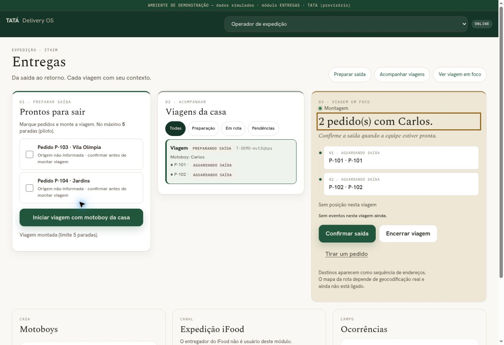

# Entregas — visual orientado à expedição

Reorganização do console existente `/console/`, preservando comandos, autorização, limite de paradas, domínio, GPS e integração iFood. Não altera a Home canônica nem o leitor de comandas.

## Estrutura

Desktop: prontos para sair → viagens da casa → viagem em foco. Apoio abaixo: motoboys, expedição iFood e ocorrências. Até 1150 px são duas colunas; até 700 px uma coluna com atalhos para etapas. Mantidos verde profundo, branco quente, creme, estados textuais e distinção de demonstração.

Viagens acessíveis por Enter/Espaço, com foco no título da investigação. Transição curta apenas no destaque da seleção; movimento reduzido remove a transição. Sequência de paradas permanece baseada em registros conhecidos, sem mapa, posição ou previsão inventada.

## Prova

23 testes existentes de UI passaram. Navegador: seleção de dois pedidos simulados, formação da viagem e abertura por teclado conferidas. Sem overflow horizontal no desktop observado nem nos quadros de 320/390 px; após compactação final do cabeçalho móvel, 320 px reconferido. Quadros responsivos não equivalem a aparelho físico. Sem certificação completa de acessibilidade.

[Quadros móveis simulados](evidencias/entregas-2026-10-29/mobile-simulado.jpg)

Capturas da implementação real com facade de demonstração em memória, sem fonte, banco ou caixa de produção. Os bairros são destinos simulados. Sem instalação, merge ou ativação. Teste no monitor do caixa e fluxo operacional autenticado continuam necessários. CI desta alteração pendente.
